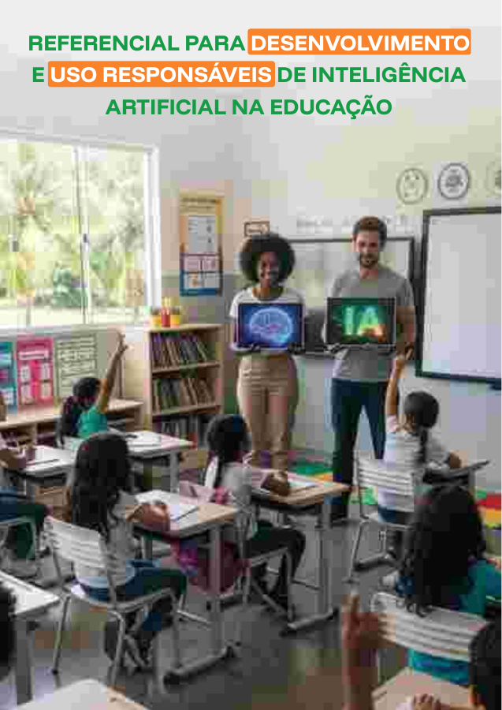
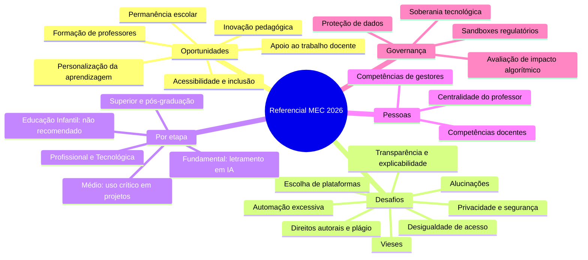
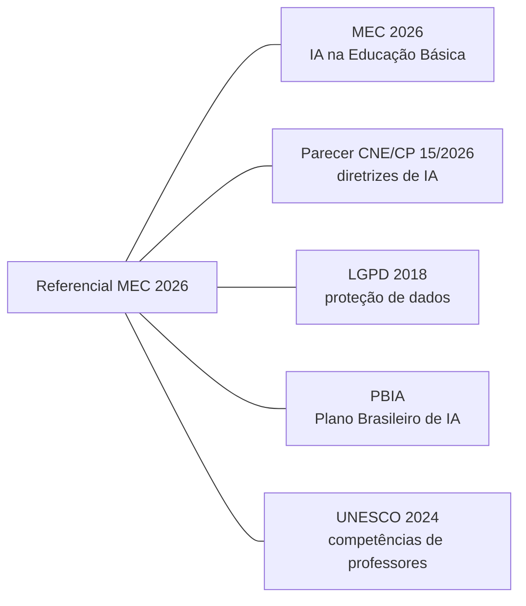

# Referencial para Desenvolvimento e Uso Responsáveis de IA na Educação (MEC, 2026)

> [!WARNING]
> **Verificação: Parcial.** Título, órgão, edição, número de páginas e trechos literais conferidos no PDF do documento (241 p.). Falta abrir o link oficial do MEC e confirmar a data de lançamento.

| | |
|---|---|
| **Tipo** | Referencial |
| **Órgão** | Ministério da Educação (MEC), Secretaria de Gestão da Informação, Inovação e Avaliação de Políticas Educacionais (SEGAPE) |
| **ID** | Sem número · 1ª edição, fevereiro de 2026 |
| **Esfera** | Federal (Brasil) |
| **Natureza** | Orientador (não vinculante) |
| **Situação** | Em vigor |
| **Nível de ensino** | Todos, da creche à pós-graduação |
| **Palavras-chave** | #referencial #etica #governanca #formacao-docente #curriculo #protecao-de-dados #gestao |
| **Link** | [gov.br/mec: Referencial de IA na Educação](https://www.gov.br/mec/pt-br/referencial-de-ia-na-educacao/referencial-ia-na-educacao) |

> [!NOTE]
> **Ementa (texto de apresentação do próprio documento):** reúne diretrizes, princípios e recomendações para promover a integração responsável, ética e socialmente comprometida da inteligência artificial nos processos educacionais.

## Mapa do documento

*Descrição do mapa:* o Referencial se organiza em cinco grandes eixos: as seis oportunidades da IA na educação, os oito desafios, as recomendações por etapa de ensino, o papel de professores e gestores e a governança da IA (proteção de dados, avaliação de impacto, ambientes de teste e soberania).

## Resumo

- Orienta o uso e o desenvolvimento de IA em **todas as etapas**, da creche à pós-graduação, e se dirige a gestores, professores, estudantes e desenvolvedores de sistemas (p. 22).
- Aponta **seis oportunidades**: apoio ao trabalho docente, personalização, permanência escolar, formação de professores, acessibilidade e inclusão, inovação pedagógica (cap. 2).
- Aponta **oito desafios**: transparência, vieses, privacidade, direitos autorais e plágio, erros factuais ("alucinações"), automação excessiva da aprendizagem, desigualdade de acesso e escolha de plataformas (cap. 2).
- Exige **supervisão humana significativa**: a IA é sempre recurso de apoio, nunca substitui o professor nem decide sozinha (p. 16 e 17).
- **Por etapa:** na Educação Infantil, não recomenda o uso de IA, salvo para incluir crianças com deficiência; no Fundamental, letramento em IA lúdico e gradual; no Médio, aprofundamento crítico e uso em projetos (p. 18).
- Dedica capítulos às **competências de professores** (cap. 5) e de **gestores** (cap. 9), à educação profissional (cap. 7) e ao ensino superior e à pesquisa (cap. 8).
- Propõe **governança**: proteção de dados (LGPD e ECA), avaliação de impacto algorítmico e sandboxes regulatórios (cap. 10).

## Trechos do documento

> **Resumo Executivo, p. 16:** "[...] o Referencial não tem por finalidade promover a substituição do trabalho docente nem a automatização irrestrita de decisões educacionais de alto impacto."

> **Resumo Executivo, p. 17:** "Constitui princípio essencial e inegociável a preservação de uma supervisão humana significativa, capaz de assegurar que profissionais da educação mantenham controle sobre processos decisórios, utilizando inteligência artificial exclusivamente como recurso de apoio."

> **Resumo Executivo, p. 18:** "Na Educação Básica, por exemplo, a prioridade deve ser a aprendizagem sobre inteligência artificial, para que estudantes e profissionais da educação compreendam a tecnologia, os potenciais e as limitações de sua integração antes de utilizá-la como recurso pedagógico."

> **Resumo Executivo, p. 18:** "Na Educação Infantil, não se recomenda o uso de inteligência artificial, exceto em situações específicas nas quais recursos tecnológicos viabilizem a inclusão de crianças com deficiência em processos de aprendizagem."

## O que significa na prática

> [!IMPORTANT]
> **Em resumo:** é o principal documento do MEC sobre IA na educação. Diz que a IA só vale quando serve ao projeto pedagógico, sempre com o professor no controle, e dá orientações para cada etapa de ensino, do professor ao gestor.

> [!TIP]
> **Na sala de aula:** na educação básica, ensinar *sobre* a IA antes de usá-la como ferramenta. Não usar IA com crianças da Educação Infantil, salvo para incluir crianças com deficiência. Planejar atividades que exijam pensamento próprio do estudante, para evitar que ele terceirize o esforço de aprender, e conferir sempre o que a IA produz.

> [!TIP]
> **Na gestão:** antes de adotar uma plataforma com IA, avaliar a necessidade real, os riscos e a proteção dos dados dos estudantes (LGPD e ECA). Manter supervisão humana nas decisões, investir em formação continuada dos professores e acompanhar o uso da tecnologia ao longo do tempo (cap. 9 e 10).

## Como citar

> [!NOTE]
> BRASIL. Ministério da Educação. Secretaria de Gestão da Informação, Inovação e Avaliação de Políticas Educacionais. *Referencial para desenvolvimento e uso responsáveis de inteligência artificial na educação*. Brasília, DF: MEC, 2026. 241 p. Disponível em: https://www.gov.br/mec/pt-br/referencial-de-ia-na-educacao/referencial-ia-na-educacao. Acesso em: [data da conferência].

## Marcos relacionados

## Observações

> [!CAUTION]
> O título aparece de duas formas: "Desenvolvimento e Uso Responsáveis" (capa e ficha técnica) e "Uso e Desenvolvimento Responsáveis" (apresentação e página do MEC). A ficha usa o título da capa. Não confundir com o documento orientador *Inteligência Artificial na Educação Básica* (MEC/SEB, 2026), que é outro documento. Segundo as diretrizes da Andifes para o ensino superior, este Referencial foi subsidiado pelo GT de IA da Andifes.
