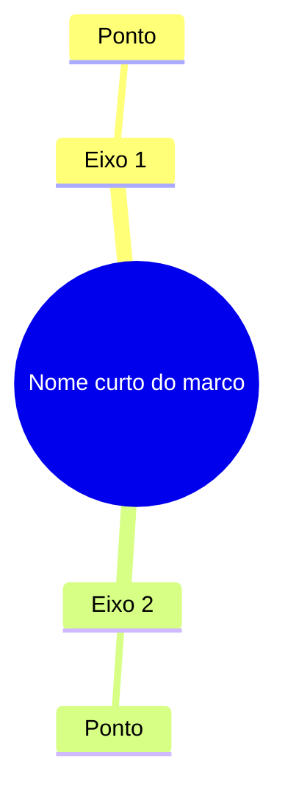
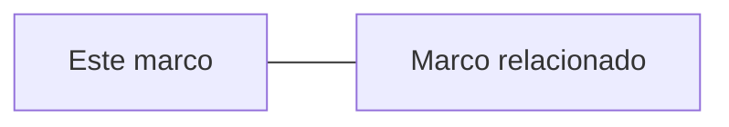

# Título

<!-- MODELO EM REVISÃO (05/11/2026). Formato visual: callouts (GitHub e Obsidian) e diagramas Mermaid.
     Callouts: [!WARNING] verificação · [!NOTE] ementa e citação · [!IMPORTANT] em resumo
     · [!TIP] sala de aula e gestão · [!CAUTION] alertas. -->

<!-- caminho relativo da ficha até site/assets/covers/ (ex.: ../../../../../site/assets/covers/<id>.png); o script confere -->

> [!WARNING]
> **Verificação: Rascunho / Parcial / Conferido / Em revisão.** O que foi conferido e onde. Remover este aviso só quando o selo for verde. Se for Em revisão: "O documento oficial mudou. Esta ficha está sendo conferida de novo."

| | |
|---|---|
| **Tipo** | |
| **Órgão** | |
| **ID** | |
| **Esfera** | |
| **Natureza** | |
| **Situação** | |
| **Nível de ensino** | |
| **Palavras-chave** | #tag1 #tag2 (as mesmas do campo `temas`, sem acento, com hífen) |
| **Correlato** | Só quando `correlato: sim`: "Documento correlato: não trata diretamente de IA, mas é base para o uso de IA na escola (motivo em uma frase)." |
| **Link** | [link](...) |

> [!NOTE]
> **Ementa oficial:** texto da ementa.

## Mapa do documento

<!-- Logo abaixo do diagrama, uma frase em texto descrevendo o mapa (acessibilidade para leitores de tela). Fazer por último, depois da conferência na fonte. É interpretação: revisar na curadoria. -->

## Resumo

- Ponto do documento (fonte).

## Trechos do documento

<!-- Texto LITERAL dos dispositivos mais importantes sobre IA, copiado da fonte oficial, com o número do artigo. Sem paráfrase. -->

> **Art. Xº** texto exato do artigo.

## O que significa na prática

> [!IMPORTANT]
> **Em resumo:** uma ou duas frases simples.

> [!TIP]
> **Na sala de aula:** decisões didáticas (só se fizer sentido).

> [!TIP]
> **Na gestão:** decisões de direção, coordenação e secretarias (só se fizer sentido).

## Como citar

> [!NOTE]
> Referência ABNT (igual ao campo `como_citar`).

## Marcos relacionados

## Nota do GT

Opcional: leitura do GT para a sugestão de ementa.

## Observações

> [!CAUTION]
> Alertas e pendências, quando houver.
