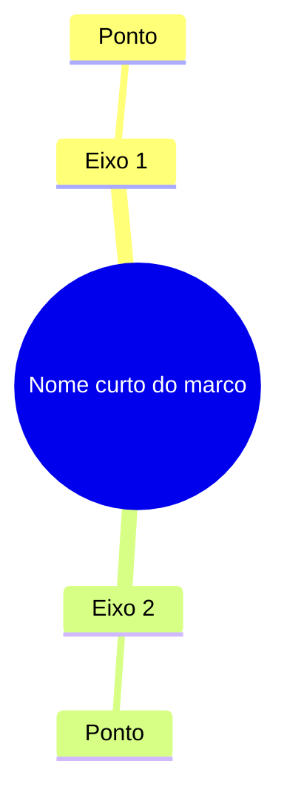
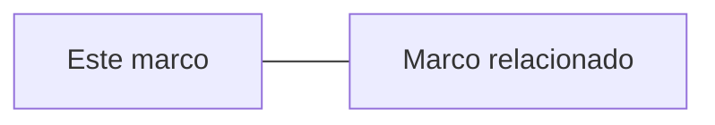

# Título

<!-- FICHA MODELO EM BRANCO (13/11/2026), feita a partir do modelo em uso (docs/modelo-ficha.md).
     Mudanças já decididas: sem "Nota do GT" (o texto vai para Observações); seções marcadas como
     [OBRIGATÓRIA] ou [QUANDO FIZER SENTIDO]; capa e mapa só depois do selo verde; selo verde com dois(duas) curadores(as).
     Formato visual: callouts (GitHub e Obsidian) e diagramas Mermaid.
     Callouts: [!WARNING] verificação · [!NOTE] ementa e citação · [!IMPORTANT] em resumo
     · [!TIP] sala de aula e gestão · [!CAUTION] alertas. -->

<!-- CAPA: só depois do selo verde. Caminho relativo da ficha até site/assets/covers/ (ex.: ../../../../../site/assets/covers/<id>.png); o script confere -->

<!-- [OBRIGATÓRIA] Aviso de verificação -->
> [!WARNING]
> **Verificação: Rascunho / Parcial / Conferido / Em revisão.** O que foi conferido e onde. Remover este aviso só quando o selo for verde. Se for Em revisão: "O documento oficial mudou. Esta ficha está sendo conferida de novo."

<!-- [OBRIGATÓRIA] Quadro de identificação -->
| | |
|---|---|
| **Tipo** | |
| **Órgão** | |
| **ID** | |
| **Esfera** | |
| **Natureza** | |
| **Situação** | |
| **Nível de ensino** | |
| **Palavras-chave** | #tag1 #tag2 (as mesmas do campo `temas`, sem acento, com hífen) |
| **Correlato** | Só quando `correlato: sim`: "Documento correlato: não trata diretamente de IA, mas é base para o uso de IA na escola (motivo em uma frase)." |
| **Link** | [link](...) |

<!-- [OBRIGATÓRIA] Ementa oficial -->
> [!NOTE]
> **Ementa oficial:** texto da ementa.

## Mapa do documento

<!-- Só depois do selo verde. Logo abaixo do diagrama, uma frase em texto descrevendo o mapa (acessibilidade para leitores de tela). É interpretação: revisar na curadoria. -->

## Resumo

<!-- [OBRIGATÓRIA] -->
- Ponto do documento (fonte).

## Trechos do documento

<!-- [OBRIGATÓRIA] Texto LITERAL dos dispositivos mais importantes sobre IA, copiado da fonte oficial, com o número do artigo. Sem paráfrase. -->
> **Art. Xº** texto exato do artigo.

## O que significa na prática

<!-- [OBRIGATÓRIA] -->
> [!IMPORTANT]
> **Em resumo:** uma ou duas frases simples.

<!-- [QUANDO FIZER SENTIDO] -->
> [!TIP]
> **Na sala de aula:** decisões didáticas.

<!-- [QUANDO FIZER SENTIDO] -->
> [!TIP]
> **Na gestão:** decisões de direção, coordenação e secretarias.

## Como citar

<!-- [OBRIGATÓRIA] -->
> [!NOTE]
> Referência ABNT (igual ao campo `como_citar`).

## Marcos relacionados

<!-- [QUANDO FIZER SENTIDO] -->

## Observações

<!-- [QUANDO FIZER SENTIDO] Alertas, pendências e, quando houver, a leitura do GT (antiga "Nota do GT"). -->
> [!CAUTION]
> Alertas e pendências, quando houver.

---

<!-- ============================================================
     SUGESTÃO DO CLAUDE (aguardando aprovação do maintainer). Não faz parte do modelo até ser aprovada.
     ============================================================ -->

## Conferência do(a) curador(a) — SUGESTÃO, aguardando aprovação

Antes de dar o OK no pré-fichamento, conferir na fonte oficial:

- [ ] O link abre e leva ao documento oficial (não a uma cópia).
- [ ] Número, data e órgão batem com o documento.
- [ ] A ementa está igual à oficial, palavra por palavra.
- [ ] Os trechos citados estão literais e com o número certo do artigo ou item.
- [ ] O resumo e o "Em resumo" não dizem nada que o documento não diz.
- [ ] A situação (em vigor, revogado etc.) está atualizada.
- [ ] A referência ABNT confere com os dados do documento.
