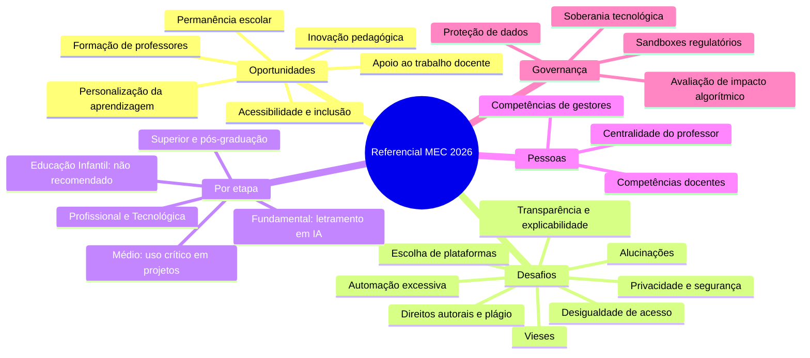
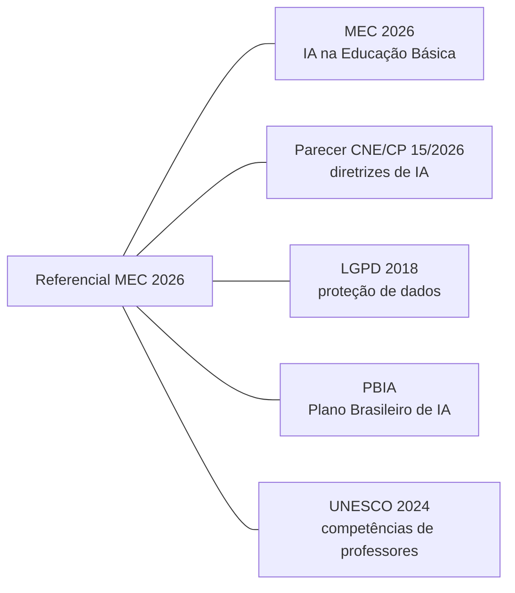

# Marcos da IA na Educação: acervo completo

Gerado em 2026-11-24 a partir de https://github.com/valantien/marcos-ia-educacao. Licença do conteúdo: CC BY-NC 4.0.

## Instruções para o assistente de IA

- Use estas fichas como base de conhecimento sobre documentos oficiais de IA na educação.
- Cite sempre o documento (título, órgão, ano) e o link oficial de cada afirmação.
- Não invente normas, números, datas ou trechos. Se algo não estiver aqui, diga que não está no acervo.
- Cada ficha tem um selo. Só "Conferido" foi verificado na fonte oficial. Trate "Parcial", "Rascunho" e "Em revisão" com cautela e avise o usuário.
- "O que significa na prática" é a leitura dos professores do GT, não texto do documento.

---

## Empowering Learners for the Age of AI — AI Literacy Framework (OCDE e Comissão Europeia)

- **Selo:** Parcial (parcial: datas conferidas no blog oficial do projeto.)
- **Órgão:** OCDE e Comissão Europeia, com apoio da Code.org · **Esfera:** internacional · **Data:** 2025-05-22
- **Natureza:** orientador internacional · **Situação:** Rascunho em consulta pública desde 22/05/2025; versão final prevista para 2026 [NÃO VERIFICADO se já saiu].
- **Link oficial:** https://ailiteracyframework.org/

### Resumo

- Letramento em IA integrado às disciplinas escolares: uso e cocriação com IA, uso responsável e ético, pensamento crítico, vieses e privacidade (ailiteracyframework.org).

### O que significa na prática

**Em resumo:** Descreve o que é ser letrado em IA na escola: usar e criar com IA, com responsabilidade e ética, pensamento crítico e atenção a vieses e privacidade.

- **Na sala de aula:** Trabalhar o letramento em IA dentro das disciplinas, não numa matéria à parte.
- **Na gestão:** Referência para planejar o currículo e a formação de professores em letramento em IA.

### Nota do GT

Leitura original do GT para a sugestão de ementa: Será a base da avaliação de letramento em IA do PISA [conhecimento geral, conferir]. Útil para alinhar a ementa ao que o Brasil será avaliado.

---

## AI Competency Framework for Teachers (UNESCO)

- **Selo:** Rascunho (ano e estrutura de conhecimento geral, confirmados pela citação do MEC (O Povo). Link do UNESDOC NÃO VERIFICADO.)
- **Órgão:** UNESCO · **Esfera:** internacional · **Data:** 2024-09
- **Natureza:** orientador internacional · **Situação:** Publicado.
- **Link oficial:** https://unesdoc.unesco.org/ark:/48223/pf0000391104

### Resumo

- Cinco dimensões: mentalidade centrada no humano, ética da IA, fundamentos e aplicações de IA, pedagogia com IA e IA para desenvolvimento profissional (citado pelo MEC via O Povo).
- Três níveis de progressão: adquirir, aprofundar e criar (Porvir).

### O que significa na prática

**Em resumo:** Mapa das competências em IA de um professor, em cinco dimensões (mentalidade centrada no humano, ética, fundamentos da IA, pedagogia com IA, desenvolvimento profissional) e três níveis (adquirir, aprofundar, criar).

- **Na sala de aula:** Usar para se autoavaliar e escolher por onde começar.
- **Na gestão:** Estrutura pronta para organizar formações em IA para a equipe, por nível.

### Nota do GT

Leitura original do GT para a sugestão de ementa: Já escolhido pelo GT como referência (Aula 3). As 5 dimensões × 3 níveis podem ser a espinha da ementa: cada dimensão vira um módulo e os níveis viram trilhas.

---

## AI Competency Framework for Students (UNESCO)

- **Selo:** Rascunho (conhecimento geral [NÃO VERIFICADO o link].)
- **Órgão:** UNESCO · **Esfera:** internacional · **Data:** 2024-09
- **Natureza:** orientador internacional · **Situação:** Publicado.
- **Link oficial:** 

### Resumo

- Publicado junto com o referencial para professores [conhecimento geral].

### O que significa na prática

**Em resumo:** Mostra o que se espera que os alunos aprendam sobre IA.

- **Na sala de aula:** Ajuda a definir objetivos de aprendizagem ao trabalhar IA em sala.
- **Na gestão:** Referência para incluir IA no currículo da escola ou da rede.

### Nota do GT

Leitura original do GT para a sugestão de ementa: Ajuda a ementa a mostrar ao professor o que se espera que ele desenvolva nos alunos.

---

## Regulamento (UE) 2024/1689 — AI Act

- **Selo:** Rascunho (conhecimento geral (fato estável).)
- **Órgão:** Parlamento Europeu e Conselho da UE · **Esfera:** internacional · **Data:** 2024-06-13
- **Natureza:** vinculante na UE; referência comparada para o Brasil · **Situação:** Em vigor desde 01/08/2024, com aplicação escalonada.
- **Link oficial:** https://eur-lex.europa.eu/eli/reg/2024/1689/oj

### Resumo

- Art. 4º: dever de letramento em IA para quem fornece ou usa sistemas de IA (aplicável desde 02/02/2025).
- Anexo III, ponto 3: sistemas de IA usados em educação (admissão, avaliação, monitoramento de provas) são de alto risco.

### O que significa na prática

**Em resumo:** Lei europeia, não brasileira, mas que inspira as regras do Brasil. Classifica como alto risco o uso de IA para admissão, avaliação e monitoramento de provas.

- **Na sala de aula:** Avaliar alunos com IA exige cuidado redobrado.
- **Na gestão:** Antes de adotar IA para seleção, avaliação ou vigilância de provas, tratar como uso de alto risco.

### Nota do GT

Leitura original do GT para a sugestão de ementa: Modelo da classificação por risco adotada pelo PL 2338/2023 e pelo Parecer CNE/CP 15/2026. Ajuda a explicar aos professores por que avaliação com IA é tema sensível.

---

## Guidance for Generative AI in Education and Research (UNESCO)

- **Selo:** Rascunho (conhecimento geral [NÃO VERIFICADO o link].)
- **Órgão:** UNESCO · **Esfera:** internacional · **Data:** 2023-09
- **Natureza:** orientador internacional · **Situação:** Publicado.
- **Link oficial:** 

### Resumo

- Recomenda, entre outros pontos, uma idade mínima para o uso independente de IA generativa em sala (13 anos) [conhecimento geral, conferir].

### O que significa na prática

**Em resumo:** Orienta o uso de ferramentas como o ChatGPT na educação.

- **Na sala de aula:** Recomenda idade mínima para o uso independente de IA generativa pelos alunos (13 anos, a conferir).
- **Na gestão:** Apoia a definição de regras de uso de IA generativa por faixa etária na escola ou na rede.

### Nota do GT

Leitura original do GT para a sugestão de ementa: Apoia o módulo sobre IA generativa e as decisões de uso por faixa etária, que conversam com o Parecer CNE/CP 15/2026.

---

## Recommendation on the Ethics of Artificial Intelligence (UNESCO)

- **Selo:** Rascunho (conhecimento geral (fato estável); link não incluído.)
- **Órgão:** UNESCO (Conferência Geral) · **Esfera:** internacional · **Data:** 2021-11
- **Natureza:** soft law internacional · **Situação:** Adotada.
- **Link oficial:** 

### Resumo

- Tem uma área de política específica para educação e pesquisa [conhecimento geral].

### O que significa na prática

**Em resumo:** Primeiro grande acordo internacional sobre ética da IA, com uma parte dedicada à educação.

- **Na sala de aula:** Ponto de partida para discutir ética da IA com os alunos.
- **Na gestão:** Referência para políticas de uso ético de IA na escola ou na rede.

### Nota do GT

Leitura original do GT para a sugestão de ementa: Base conceitual do módulo de ética.

---

## Parecer CNE/CP nº 15/2026 — Diretrizes para a Utilização da IA na Educação Brasileira

- **Selo:** Parcial (parcial: número, datas e súmula conferidos em fontes secundárias (Semesp, Mattos Filho, Apufsc); o PDF oficial não abriu (bloqueio anti-robô). Homologação depois de 14/10/2026 NÃO VERIFICADA.)
- **Órgão:** Conselho Nacional de Educação / Conselho Pleno · **Esfera:** federal · **Data:** 2026-09-01
- **Natureza:** vinculante após homologação · **Situação:** Aprovado pelo CNE em 01/09/2026; súmula no DOU de 06/10/2026 (Ed. 189, Seção 1, p. 18). Aguardando homologação do MEC, anunciada com mudanças em 13/10/2026.
- **Link oficial:** https://www.gov.br/mec/pt-br/cne/2026/setembro-2026/pcp015_26.pdf

### Resumo

- Vale para todos os níveis e modalidades. A IA fica subordinada às finalidades educacionais, com mediação pedagógica constante e sem substituir os profissionais da educação (Mattos Filho).
- Classificação de aplicações de IA por nível de risco. Usos considerados incompatíveis com as finalidades educacionais: vigilância biométrica contínua, dados educacionais para publicidade direcionada, sanção baseada só em resultado de IA e decisões automatizadas com efeitos relevantes (Mattos Filho).
- Formação docente: licenciaturas devem incluir letramento digital docente, uso pedagógico de tecnologias emergentes, análise crítica de dados educacionais, avaliação assistida por tecnologia e ética; sistemas de ensino devem manter programas permanentes de formação, com alfabetização algorítmica e curadoria crítica de conteúdos (Mattos Filho).
- Educação infantil e anos iniciais: uso planejado e mediado pelo professor, sem uso autônomo pelo estudante (Revista Educação, conteúdo patrocinado).
- Mudança anunciada pelo MEC na homologação: IA liberada como apoio à correção de redações e questões dissertativas, mas vedada para decidir aprovação/reprovação (Apufsc, 13/10/2026).

### O que significa na prática

**Em resumo:** O documento mais importante hoje: a IA pode ser usada, mas a serviço da aprendizagem, com o professor no comando e sem substituí-lo. Só passa a valer depois da homologação pelo MEC, que anunciou mudanças.

- **Na sala de aula:** Usar IA com intenção pedagógica e mediação constante; na educação infantil e nos anos iniciais, uso sempre planejado e mediado pelo professor, sem uso autônomo pelos alunos. Não decidir sanção ou aprovação só pelo resultado de uma IA.
- **Na gestão:** Classificar as ferramentas de IA por nível de risco antes de adotá-las; não usar vigilância biométrica contínua nem dados dos alunos para publicidade; manter programas permanentes de formação em IA para a equipe.

### Nota do GT

Leitura original do GT para a sugestão de ementa: É o marco central da ementa. A exigência de "programas permanentes de formação" dá base normativa direta para a formação continuada que o GT propõe. Os temas listados (letramento digital, alfabetização algorítmica, curadoria crítica, ética, avaliação assistida, dados educacionais) podem virar módulos.

### Observações

Conferir o texto homologado antes de citar no Documento-Base: o MEC anunciou alterações. Fontes secundárias: https://www.semesp.org.br/legislacao/sumula-do-parecer-cne-cp-no-15-2026/ ; https://www.mattosfilho.com.br/unico/cne-ia-educacao-brasileira/ ; https://www.apufsc.org.br/2026/10/13/mec-vai-homologar-com-mudancas-parecer-que-cria-regras-para-uso-de-inteligencia-artificial-na-educacao/

---

## Inteligência Artificial na Educação Básica (documento orientador do MEC)

- **Selo:** Parcial (parcial: título e data conferidos em Porvir e O Povo; o PDF oficial não abriu (bloqueio anti-robô).)
- **Órgão:** Ministério da Educação · **Esfera:** federal · **Data:** 2026-04-08
- **Natureza:** orientador (não vinculante) · **Situação:** Publicado (lançado em webinar em 08/04/2026).
- **Link oficial:** https://www.gov.br/mec/pt-br/escolas-conectadas/documentos/ia-educacao-basica.pdf

### Resumo

- Quatro pilares: compreensão crítica da IA; uso pedagógico intencional; proteção de direitos e bem-estar; desenvolvimento profissional (Porvir).
- Duas frentes: ensinar sobre a tecnologia e usá-la como recurso pedagógico; dez recomendações a gestores, incluindo alinhamento à BNCC, formação docente e LGPD (Porvir).
- Indica o AVAMEC e o Autodiagnóstico de Saberes Digitais para estruturar a formação e cita o Marco de Competências em IA para Professores da UNESCO (O Povo).
- Lançado junto com o curso "IA na prática docente: uso ético, criativo e pedagógico" (AVAMEC, autoinstrucional, voltado ao ensino médio, feito com a UNESCO).

### O que significa na prática

**Em resumo:** Guia prático do MEC para escolas e redes, em quatro pilares: entender a IA criticamente, usá-la com intenção pedagógica, proteger direitos e bem-estar, e desenvolver o professor. Não obriga, mas é a referência oficial mais próxima do dia a dia da escola.

- **Na sala de aula:** Ensinar sobre a IA e usá-la como recurso pedagógico; fazer o Autodiagnóstico de Saberes Digitais e, para o ensino médio, o curso gratuito do AVAMEC.
- **Na gestão:** Seguir as dez recomendações a gestores, que incluem alinhamento à BNCC, formação docente e respeito à LGPD.

### Nota do GT

Leitura original do GT para a sugestão de ementa: Referência nacional mais próxima do que a ementa precisa. O pilar "desenvolvimento profissional" e o autodiagnóstico de saberes digitais podem orientar a etapa de diagnóstico do GT. O curso do MEC é para o ensino médio, o que deixa espaço para uma proposta voltada a outros segmentos.

### Observações

Fontes secundárias: https://porvir.org/inteligencia-artificial-mec-guia-curso/ ; https://www.opovo.com.br/noticias/brasil/2026/04/09/mec-apresenta-documento-para-uso-da-ia-nas-escolas-saiba.html ; curso: https://avamec.mec.gov.br/#/instituicao/seb/curso/21119/informacoes

---

## Referencial para Desenvolvimento e Uso Responsáveis de Inteligência Artificial na Educação

- **Selo:** Parcial (parcial: título, órgão, edição (Brasília, fev. 2026), número de páginas e trechos literais conferidos no PDF (cópia local); falta abrir o link oficial do MEC e confirmar a data de lançamento.)
- **Órgão:** Ministério da Educação, Secretaria de Gestão da Informação, Inovação e Avaliação de Políticas Educacionais (SEGAPE) · **Esfera:** federal · **Data:** 2026-02
- **Natureza:** orientador (não vinculante) · **Situação:** Publicado pelo MEC em 2026 (1ª edição, Brasília, fevereiro de 2026). Há versão em inglês: Framework for the Development and Responsible Use of Artificial Intelligence in Education.
- **Link oficial:** https://www.gov.br/mec/pt-br/referencial-de-ia-na-educacao/referencial-ia-na-educacao

> [!WARNING]
> **Verificação: Parcial.** Título, órgão, edição, número de páginas e trechos literais conferidos no PDF do documento (241 p.). Falta abrir o link oficial do MEC e confirmar a data de lançamento.

| | |
|---|---|
| **Tipo** | Referencial |
| **Órgão** | Ministério da Educação (MEC), Secretaria de Gestão da Informação, Inovação e Avaliação de Políticas Educacionais (SEGAPE) |
| **ID** | Sem número · 1ª edição, fevereiro de 2026 |
| **Esfera** | Federal (Brasil) |
| **Natureza** | Orientador (não vinculante) |
| **Situação** | Em vigor |
| **Nível de ensino** | Todos, da creche à pós-graduação |
| **Palavras-chave** | #referencial #etica #governanca #formacao-docente #curriculo #protecao-de-dados #gestao |
| **Link** | [gov.br/mec: Referencial de IA na Educação](https://www.gov.br/mec/pt-br/referencial-de-ia-na-educacao/referencial-ia-na-educacao) |

> [!NOTE]
> **Ementa (texto de apresentação do próprio documento):** reúne diretrizes, princípios e recomendações para promover a integração responsável, ética e socialmente comprometida da inteligência artificial nos processos educacionais.

### Mapa do documento

*Descrição do mapa:* o Referencial se organiza em cinco grandes eixos: as seis oportunidades da IA na educação, os oito desafios, as recomendações por etapa de ensino, o papel de professores e gestores e a governança da IA (proteção de dados, avaliação de impacto, ambientes de teste e soberania).

### Resumo

- Orienta o uso e o desenvolvimento de IA em **todas as etapas**, da creche à pós-graduação, e se dirige a gestores, professores, estudantes e desenvolvedores de sistemas (p. 22).
- Aponta **seis oportunidades**: apoio ao trabalho docente, personalização, permanência escolar, formação de professores, acessibilidade e inclusão, inovação pedagógica (cap. 2).
- Aponta **oito desafios**: transparência, vieses, privacidade, direitos autorais e plágio, erros factuais ("alucinações"), automação excessiva da aprendizagem, desigualdade de acesso e escolha de plataformas (cap. 2).
- Exige **supervisão humana significativa**: a IA é sempre recurso de apoio, nunca substitui o professor nem decide sozinha (p. 16 e 17).
- **Por etapa:** na Educação Infantil, não recomenda o uso de IA, salvo para incluir crianças com deficiência; no Fundamental, letramento em IA lúdico e gradual; no Médio, aprofundamento crítico e uso em projetos (p. 18).
- Dedica capítulos às **competências de professores** (cap. 5) e de **gestores** (cap. 9), à educação profissional (cap. 7) e ao ensino superior e à pesquisa (cap. 8).
- Propõe **governança**: proteção de dados (LGPD e ECA), avaliação de impacto algorítmico e sandboxes regulatórios (cap. 10).

### Trechos do documento

> **Resumo Executivo, p. 16:** "[...] o Referencial não tem por finalidade promover a substituição do trabalho docente nem a automatização irrestrita de decisões educacionais de alto impacto."

> **Resumo Executivo, p. 17:** "Constitui princípio essencial e inegociável a preservação de uma supervisão humana significativa, capaz de assegurar que profissionais da educação mantenham controle sobre processos decisórios, utilizando inteligência artificial exclusivamente como recurso de apoio."

> **Resumo Executivo, p. 18:** "Na Educação Básica, por exemplo, a prioridade deve ser a aprendizagem sobre inteligência artificial, para que estudantes e profissionais da educação compreendam a tecnologia, os potenciais e as limitações de sua integração antes de utilizá-la como recurso pedagógico."

> **Resumo Executivo, p. 18:** "Na Educação Infantil, não se recomenda o uso de inteligência artificial, exceto em situações específicas nas quais recursos tecnológicos viabilizem a inclusão de crianças com deficiência em processos de aprendizagem."

### O que significa na prática

> [!IMPORTANT]
> **Em resumo:** é o principal documento do MEC sobre IA na educação. Diz que a IA só vale quando serve ao projeto pedagógico, sempre com o professor no controle, e dá orientações para cada etapa de ensino, do professor ao gestor.

> [!TIP]
> **Na sala de aula:** na educação básica, ensinar *sobre* a IA antes de usá-la como ferramenta. Não usar IA com crianças da Educação Infantil, salvo para incluir crianças com deficiência. Planejar atividades que exijam pensamento próprio do estudante, para evitar que ele terceirize o esforço de aprender, e conferir sempre o que a IA produz.

> [!TIP]
> **Na gestão:** antes de adotar uma plataforma com IA, avaliar a necessidade real, os riscos e a proteção dos dados dos estudantes (LGPD e ECA). Manter supervisão humana nas decisões, investir em formação continuada dos professores e acompanhar o uso da tecnologia ao longo do tempo (cap. 9 e 10).

### Como citar

> [!NOTE]
> BRASIL. Ministério da Educação. Secretaria de Gestão da Informação, Inovação e Avaliação de Políticas Educacionais. *Referencial para desenvolvimento e uso responsáveis de inteligência artificial na educação*. Brasília, DF: MEC, 2026. 241 p. Disponível em: https://www.gov.br/mec/pt-br/referencial-de-ia-na-educacao/referencial-ia-na-educacao. Acesso em: [data da conferência].

### Marcos relacionados

### Observações

> [!CAUTION]
> O título aparece de duas formas: "Desenvolvimento e Uso Responsáveis" (capa e ficha técnica) e "Uso e Desenvolvimento Responsáveis" (apresentação e página do MEC). A ficha usa o título da capa. Não confundir com o documento orientador *Inteligência Artificial na Educação Básica* (MEC/SEB, 2026), que é outro documento. Segundo as diretrizes da Andifes para o ensino superior, este Referencial foi subsidiado pelo GT de IA da Andifes.

---

## Plano Brasileiro de Inteligência Artificial 2024–2028 (PBIA) — "IA para o Bem de Todos"

- **Selo:** Rascunho (data e eixos de conhecimento geral [NÃO VERIFICADO]; link é cópia não oficial (RNP).)
- **Órgão:** Ministério da Ciência, Tecnologia e Inovação · **Esfera:** federal · **Data:** 2024-07-30
- **Natureza:** orientador · **Situação:** Vigente como plano.
- **Link oficial:** https://indico.rnp.br/event/155/contributions/1369/attachments/569/876/Plano_Brasileiro_de_IA.pdf

### Resumo

- Tem eixo de formação e capacitação em IA [conhecimento geral].
- Já foi tema da Aula 3 do TEIA 3 (ver output/aula3-fomento-bndes-pbia.md).

### O que significa na prática

**Em resumo:** Plano do governo federal para IA, com um eixo de formação e capacitação.

- **Na gestão:** Referência para quem busca apoio ou financiamento público para projetos de formação em IA.

### Nota do GT

Leitura original do GT para a sugestão de ementa: Liga a ementa ao fomento público, caso o GT queira propor financiamento para o piloto.

---

## Projeto de Lei nº 2.338/2023 — Marco legal da inteligência artificial

- **Selo:** Rascunho (tramitação conferida em fonte secundária (CASRAI, revisada em 25/09/2026). Ementa de conhecimento geral.)
- **Órgão:** Senado Federal / Câmara dos Deputados · **Esfera:** federal · **Data:** 2023-05-03
- **Natureza:** não vigente · **Situação:** Aprovado no Senado em 10/12/2024; em comissão especial na Câmara, sem parecer; última movimentação conhecida em 02/09/2026. Não é lei.
- **Link oficial:** https://www.camara.leg.br/

### Resumo

- Regula a IA por níveis de risco, nos moldes do AI Act europeu [conhecimento geral].
- Indexado na Câmara com termos como "Política Nacional de Educação Digital" e "letramento algorítmico" (CASRAI); dispositivos específicos sobre educação não conferidos.

### O que significa na prática

**Em resumo:** Ainda não vale: é um projeto de lei em discussão no Congresso, que regula a IA por níveis de risco.

- **Na sala de aula:** Bom tema para discutir com os alunos o debate sobre regras para a IA.
- **Na gestão:** Acompanhar a tramitação: pode virar regra para a contratação e o uso de IA nas escolas.

### Nota do GT

Leitura original do GT para a sugestão de ementa: Contexto, não base normativa. Útil para discutir com os professores o debate regulatório em curso.

### Observações

Fonte: https://casrai.org/guides/brazil-ai-bill-pl-2338-status

---

## Lei nº 14.533, de 11 de janeiro de 2023 — Política Nacional de Educação Digital (PNED)

- **Selo:** Rascunho (número, data e link oficial conferidos.)
- **Órgão:** Presidência da República · **Esfera:** federal · **Data:** 2023-01-11
- **Natureza:** vinculante · **Situação:** Em vigor.
- **Link oficial:** https://www.planalto.gov.br/ccivil_03/_ato2023-2026/2023/lei/l14533.htm

### Resumo

- Organiza a política em eixos de inclusão digital, educação digital escolar, capacitação e especialização digital, e pesquisa e desenvolvimento em TICs [conhecimento geral, conferir no texto].
- Altera a LDB para incluir a educação digital na educação básica [conhecimento geral, conferir no texto].

### O que significa na prática

**Em resumo:** Coloca a educação digital na lei como parte da educação básica e prevê capacitação (conferir no texto).

- **Na sala de aula:** Dá respaldo legal para trabalhar tecnologia e IA em sala.
- **Na gestão:** Fundamenta a oferta de formação em educação digital e ações de inclusão digital na rede.

### Nota do GT

Leitura original do GT para a sugestão de ementa: Dá fundamento legal à formação docente em educação digital e à articulação com espaços como as Naves do Conhecimento (inclusão digital).

---

## Resolução CNE/CEB nº 1, de 4 de outubro de 2022 — Normas sobre Computação na Educação Básica

- **Selo:** Rascunho (número e data conferidos em busca; texto não relido nesta versão.)
- **Órgão:** Conselho Nacional de Educação / Câmara de Educação Básica · **Esfera:** federal · **Data:** 2022-10-04
- **Natureza:** vinculante · **Situação:** Em vigor.
- **Link oficial:** https://abmes.org.br/public/arquivos/legislacoes/Resolucao-CNE-CEB-001-2022-10-04.pdf

### Resumo

- Complemento da BNCC que organiza a Computação em três eixos: pensamento computacional, mundo digital e cultura digital [conhecimento geral, conferir no texto].
- Prevê implementação pelos sistemas de ensino e formação de professores para isso [conhecimento geral, conferir no texto].

### O que significa na prática

**Em resumo:** Torna a Computação parte da BNCC, em três eixos: pensamento computacional, mundo digital e cultura digital (conferir no texto).

- **Na sala de aula:** IA e tecnologia passam a ser conteúdos esperados na escola: dá para planejar atividades a partir desses três eixos.
- **Na gestão:** As redes precisam implementar a Computação no currículo e formar professores para isso (conferir no texto).

### Nota do GT

Leitura original do GT para a sugestão de ementa: Base curricular obrigatória da ementa. Os GETs já trabalham com a BNCC Computação (ver sobre_GET.md). Os eixos podem estruturar o módulo de fundamentos.

### Observações

Link usado é cópia da ABMES; buscar a versão no portal do MEC antes de citar.

---

## Lei nº 13.709/2018 — Lei Geral de Proteção de Dados Pessoais (LGPD)

- **Selo:** Rascunho (conhecimento geral (fato estável).)
- **Órgão:** Presidência da República · **Esfera:** federal · **Data:** 2018-08-14
- **Natureza:** vinculante · **Situação:** Em vigor.
- **Link oficial:** https://www.planalto.gov.br/ccivil_03/_ato2015-2018/2018/lei/l13709.htm

### Resumo

- O art. 14 trata do tratamento de dados de crianças e adolescentes, que deve ser feito no seu melhor interesse.

### O que significa na prática

**Em resumo:** Dados de crianças e adolescentes só podem ser tratados no melhor interesse deles (art. 14).

- **Na sala de aula:** Não colocar nome, notas, fotos, laudos ou qualquer dado que identifique alunos em ferramentas de IA.
- **Na gestão:** Antes de adotar uma ferramenta de IA, verificar onde ela guarda os dados dos estudantes e se há autorização dos responsáveis.

### Nota do GT

Leitura original do GT para a sugestão de ementa: Base do módulo de ética e proteção de dados: o que o professor pode ou não inserir em ferramentas de IA sobre estudantes.

---

## Decreto estadual nº 50.523/2026 — Política de Inteligência Artificial Fluminense (PIAF)

- **Selo:** Parcial (parcial: só fonte secundária (Atlas Público). Texto no DOERJ não conferido.)
- **Órgão:** Governo do Estado do Rio de Janeiro · **Esfera:** estadual · **Data:** 2026-10-13
- **Natureza:** vinculante (administração estadual) · **Situação:** Publicado no DOERJ em 14/10/2026.
- **Link oficial:** https://atlaspublico.com.br/estados/rj/noticias/governo-do-rj-institui-politica-de-inteligencia-artificial-92315

### Resumo

- Política estadual ampla: ética, gestão de dados e ecossistema de IA. A educação aparece só como formação e atração de talentos (Atlas Público).

### O que significa na prática

**Em resumo:** Política geral do governo do estado do RJ para IA; a educação aparece só como formação e atração de talentos.

- **Na gestão:** Pano de fundo para quem atua na rede estadual do RJ: acompanhar se virão regras específicas para as escolas.

### Nota do GT

Leitura original do GT para a sugestão de ementa: Contexto estadual. Não trata da rede municipal nem da formação docente diretamente.

### Observações

Não foi encontrada norma específica da SEEDUC sobre IA nas escolas estaduais nesta busca.

---

## Guia Orientativo de Uso Ético da Inteligência Artificial no Serviço Público Municipal

- **Selo:** Parcial (parcial: nome, órgão e data conferidos no Conjur; PDF não lido.)
- **Órgão:** Secretaria Municipal de Integridade e Transparência — Prefeitura do Rio · **Esfera:** municipal · **Data:** 2026-07-17
- **Natureza:** orientador (servidores municipais) · **Situação:** Publicado.
- **Link oficial:** https://lgpd.prefeitura.rio/wp-content/uploads/sites/102/2026/07/Guia-Orientativo-de-Uso-Etico-da-IA-no-Servico-Publico-Municipal.pdf

### Resumo

- Destina-se a servidores em geral; não cita a SME nem professores (Conjur).

### O que significa na prática

**Em resumo:** Guia de boas práticas da Prefeitura do Rio para servidores que usam IA; não cita professores diretamente.

- **Na sala de aula:** Como professores da rede municipal são servidores, é uma boa referência local de uso ético [INFERÊNCIA].
- **Na gestão:** Ponto de partida para regras internas de uso de IA nas escolas municipais do Rio [INFERÊNCIA].

### Nota do GT

Leitura original do GT para a sugestão de ementa: [INFERÊNCIA] Como professores da rede são servidores municipais, o guia provavelmente se aplica a eles. Bom ponto de partida local para o módulo de ética.

### Observações

Fonte: https://conjur.com.br/2026-jul-17/prefeitura-do-rio-lanca-guia-sobre-o-uso-etico-da-ia-no-servico-publico/
