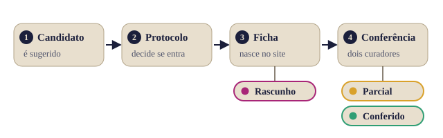

# Regras de curadoria

**As regras para escolher os documentos do acervo: o que entra, o que fica fora, quem decide e como cada ficha ganha o selo de conferida.**

Estas regras valem para quem sugere, ficha ou confere um documento. Elas seguem o Protocolo de Curadoria do Grupo de Trabalho (GT).

## Princípios

- **Projeto coletivo.** O acervo é dos professores do GT Formação de Professores em IA (TEIA 3, CBAE/UFRJ). A curadoria é responsabilidade do grupo.
- **Curadoria humana.** Professores selecionam, leem, resumem e conferem cada documento. Ferramentas automáticas e assistentes de IA só ajudam a encontrar documentos, a rascunhar fichas e a avisar mudanças. Essas ferramentas nunca decidem o que entra no acervo e nunca dão o selo de conferido. Quem decide é o protocolo, aplicado por professores.
- **Transparência.** Toda ficha aparece no site desde o rascunho, com o selo da fase em que está. Toda decisão fica registrada em público.
- **Acesso aberto.** Qualquer pessoa pode consultar o acervo, de forma livre e gratuita.

## O que entra no acervo

Um documento entra quando a resposta é "sim" nestas cinco perguntas:

1. **A IA é o tema central do documento?** Sim, quando a IA está no título ou no objeto, ou quando tem uma parte própria (capítulo, seção ou anexo). Citar a IA só de passagem não basta.
2. **O documento tem relação com a educação?** A relação pode ser **direta** (o documento fala de escola, ensino, aprendizagem, professores, estudantes, pesquisa ou publicação científica) ou **indireta** (é lei, decreto, regulamento ou plano de IA que vale também para escolas e universidades, mesmo sem citá-las). Exemplos de relação indireta: o AI Act e o Projeto de Lei 2.338/2023. Um guia geral de IA, sem parte dedicada ao ensino, fica de fora.
3. **Quem publicou?** Um órgão público brasileiro (federal, estadual ou municipal, incluindo universidades e institutos públicos) ou um organismo internacional ou bloco de países (UNESCO, OCDE, União Europeia). Governos de outros países ficam de fora nesta primeira fase.
4. **É uma norma ou uma orientação?** O documento regula ou orienta em nome de quem o publica, e qualquer pessoa pode ler o texto completo de graça na fonte oficial. Estudos, relatórios e artigos ficam de fora, mesmo quando um órgão oficial os publica.
5. **É novo para o acervo?** Uma nova versão de um documento que já está no acervo (por exemplo, a homologação de um parecer) atualiza a ficha que existe. Não cria uma ficha nova.

Projetos de lei entram com a natureza "não vigente". Documentos revogados ou alterados continuam no acervo, e a ficha registra a situação.

### Duas outras formas de entrada

- **Documento correlato.** Não trata de IA, mas é base para o uso da IA no ensino. No site, aparece com a etiqueta "correlato". O acervo só aceita correlatos de temas que o GT aprovou. Hoje são três: proteção de dados pessoais (LGPD), educação digital (Política Nacional de Educação Digital) e ensino de computação (Resolução CNE/CEB 1/2022). Um tema novo só vale depois que o GT o aprova.
- **Exceção.** Um documento de associação ou entidade científica pode entrar quando passa nas perguntas 1, 2, 4 e 5 e cumpre uma destas condições: (a) a entidade fez o documento a pedido de um órgão público, para dar base a uma política ou norma oficial; (b) o documento é norma ou orientação de entidade científica de referência, sem fins lucrativos e com alcance amplo. Cada exceção é registrada com a condição que a justifica. Exemplos: as diretrizes da Andifes e o manual da ANPAD.

## O que fica fora

- Pesquisas, relatórios, estudos, livros, artigos, materiais didáticos e relatos de experiência.
- Documentos de empresas, de editoras comerciais e de instituições privadas.
- Documentos de governos de outros países.
- Textos com autoria individual (ensaios e artigos assinados).
- Documentos que citam IA só de passagem, e documentos que não tratam de IA e não pertencem a um tema correlato aprovado.
- Documentos sem acesso público e gratuito.

Um documento que deixa de cumprir as regras **não é apagado**. Ele fica guardado, com o motivo, na pasta `corpus/fora-do-recorte/`.

## O caminho de uma ficha

Do candidato ao selo **Conferido**, cada documento passa por estas etapas.

## Quem decide

**Quem decide é o protocolo.** Cada documento passa pelas cinco perguntas, e a resposta define se ele entra. As pessoas aplicam essas regras e não escolhem caso a caso. Quando a regra deixa dúvida, o GT decide por consenso.

| Papel | O que faz |
|---|---|
| **GT** | Aprova as regras e as mudanças nelas, aprova temas correlatos novos, decide os casos em que a regra deixa dúvida e decide os pedidos de revisão, sempre por consenso. |
| **Curadores(as)** | Professores do GT que escrevem as fichas e as conferem na fonte oficial. |
| **Maintainer** | Um(a) curador(a) indicado(a) pelo GT. Aplica o protocolo a cada documento, registra o resultado e publica no repositório. Consulta o GT quando a regra deixa dúvida. |
| **Colaboradores(as)** | Qualquer pessoa. Sugere documentos e indica erros. Não decide o que entra e não confere fichas. |

Um assistente de IA pode aplicar as cinco perguntas a uma lista de candidatos e entregar uma recomendação com o motivo. Ele só recomenda. Quem decide é o protocolo, aplicado pelo(a) maintainer. Cada decisão, aceita ou recusada, fica no [registro de triagem](../../docs/log-triagem.md).

## Verificação e selos

A conferência na fonte oficial é o centro do acervo. Cada ficha mostra o selo da fase em que está:

| Selo | Quando |
|---|---|
| **Rascunho** | A ficha foi criada e ainda não foi conferida. |
| **Parcial** | Parte dos dados foi confirmada, por exemplo, só em fonte secundária. |
| **Conferido** | Número, data, ementa, trechos e link foram conferidos na fonte oficial. |
| **Em revisão** | O documento oficial mudou, e a ficha está sendo conferida de novo. |

- Quem confere compara a ficha com o documento oficial, lado a lado. Fatos como número, data, órgão, ementa, trechos literais, link e situação atual precisam bater exatamente.
- O selo **Conferido** exige a conferência de dois(duas) curadores(as). A ficha registra só a data da conferência, sem nomes.
- Sempre que a informação não foi conferida, a ficha marca [NÃO VERIFICADO], [INFERÊNCIA] ou "conhecimento geral". Nada de número, data, link ou citação inventados.
- Quando as fontes divergem, a ficha registra a divergência em vez de escolher uma versão.

## Como escrever a ficha

- **Para quem:** professores, pesquisadores e gestores da educação, e o público em geral. Linguagem simples.
- **Separar o que o documento diz da leitura do GT.** O "Resumo" e os "Trechos do documento" trazem só o que está no documento, com a fonte. "O que significa na prática" traz a leitura do GT e não afirma nada que não esteja no resumo.
- O formato completo está no [modelo de ficha](../../docs/modelo-ficha.md).
