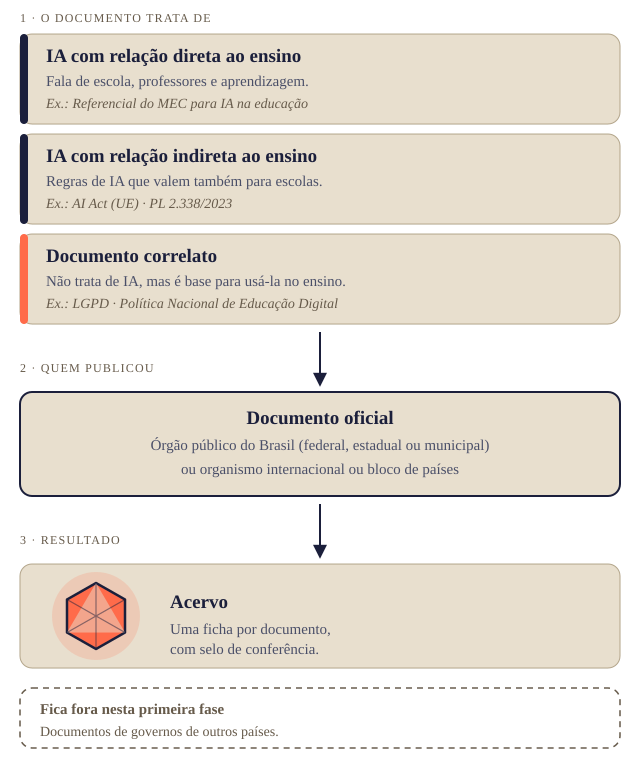

# Sobre o acervo

**Uma base aberta de conhecimento sobre os documentos que orientam e regulam a inteligência artificial no ensino. A curadoria é feita por professores. O acervo fica no GitHub e pode ser consultado por pessoas neste site e por assistentes de IA.**

## O que é

Uma coleção de documentos oficiais sobre **inteligência artificial (IA) no ensino**: leis, decretos, resoluções, pareceres, planos, referenciais e guias.

Cada documento ganha uma **ficha**. A ficha diz o que o documento é, quem o publicou, se ele obriga ou só orienta, e traz um resumo, o que ele significa na prática e o link para a fonte oficial.

## O que entra no acervo

Entram três tipos de documento:

- **IA com relação direta ao ensino.** Exemplo: o Referencial do MEC para o uso responsável de IA na educação.
- **IA com relação indireta ao ensino.** São regras de IA que valem também para escolas e universidades, mesmo sem citá-las. Exemplos: o AI Act, da União Europeia, e o Projeto de Lei 2.338/2023.
- **Documentos correlatos.** Não tratam de IA, mas são base para usá-la no ensino. Exemplos: a LGPD e a Política Nacional de Educação Digital. No site, eles aparecem com a etiqueta "correlato".

Só entram documentos **oficiais**, publicados por órgão público do Brasil (federal, estadual ou municipal) ou por organismo internacional ou bloco de países, como UNESCO, OCDE e União Europeia. Nesta primeira fase, documentos de governos de outros países ficam de fora.

As regras completas estão em [Curadoria](curadoria.md).

## Para quem serve

Para professores, pesquisadores e gestores da educação, que tomam decisões didáticas ou técnico-administrativas sobre o uso de IA em escolas e universidades.

O acervo é aberto também ao **público em geral**. Qualquer pessoa pode consultar os documentos e as fichas, de forma livre e gratuita.

## Por que a curadoria humana importa

Professores selecionam, leem, resumem e conferem cada documento. Ferramentas automáticas e assistentes de IA só ajudam a encontrar documentos e a avisar quando algo muda. Essas ferramentas nunca decidem o que entra e nunca dão o selo de conferido. É nisso que está o valor do acervo.

**Acervo em construção.** Toda ficha aparece no site desde o rascunho, com o selo da fase em que está. Fichas sem o selo Conferido ainda não foram conferidas na fonte oficial. Confira o documento antes de citar.

## Três formas de usar o mesmo conteúdo

1. **Neste site**, explorando o mapa ou buscando na lista do Acervo.
2. **Com um assistente de IA**, baixando o arquivo único ou apontando o repositório para o seu agente. Veja [Use com sua IA](usar-com-ia.md).
3. **No repositório do GitHub**, onde cada ficha é um arquivo de texto com o histórico de todas as mudanças.

## Quem faz

É um projeto coletivo dos professores do **GT Formação de Professores em IA** (TEIA 3), do **Colégio Brasileiro de Altos Estudos da UFRJ (CBAE/UFRJ)**. Veja [Quem faz](quem-faz.md).

## Como citar

> GT FORMAÇÃO DE PROFESSORES EM IA (TEIA 3, CBAE/UFRJ). *Marcos da IA na Educação*: base aberta de conhecimento sobre os documentos que orientam e regulam a IA no ensino. Rio de Janeiro, 2026. Disponível em: https://valantien.github.io/marcos-ia-educacao. Acesso em: [data].

## Licença

O conteúdo escrito pelo GT (fichas, textos do site e glossário) está sob a licença **Creative Commons Atribuição-NãoComercial 4.0 (CC BY-NC 4.0)**. Você pode copiar e adaptar, citando o acervo, sem uso comercial. Os documentos oficiais pertencem aos órgãos que os publicaram.

