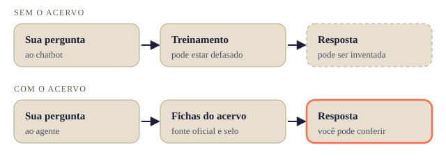

# Use com sua IA

O acervo foi pensado para ser lido por **pessoas** e por **agentes de IA**.

Um chatbot responde com base no que aprendeu no treinamento. Esse conteúdo pode estar desatualizado ou incompleto, e pode nem incluir as normas brasileiras e internacionais mais recentes. Quando falta informação, o chatbot pode escrever uma resposta convincente e errada. Isso se chama **alucinação**: por exemplo, citar uma lei que não existe, ou atribuir a um decreto algo que ele não diz. Se você pergunta "o que a lei diz sobre IA na escola?" sem indicar a fonte, esse risco existe.

Quando você aponta o agente para este repositório GitHub, ele lê as fichas do acervo, que trazem o link da fonte oficial e o selo de verificação. A resposta passa a se basear em marcos legais que você pode conferir. Isso reduz o risco de alucinação, mas não o elimina.

## Em um chat (ChatGPT, Gemini, Claude no navegador)

O chat usa o **arquivo único do acervo**: um texto simples (Markdown) que reúne todas as fichas, cada uma com o seu selo, e traz instruções para a IA citar a fonte e não inventar normas. Há dois modos, o primário e o secundário, de entregar esse arquivo ao chatbot.

### Modo primário: pelo endereço (recomendado)

Os chatbots atuais conseguem abrir endereços da internet, então não é preciso baixar nem anexar nada.

1. Copie o endereço do [arquivo único do acervo](data/acervo-completo.md): `https://valantien.github.io/marcos-ia-educacao/data/acervo-completo.md`.
2. Cole o endereço na conversa e peça que a IA leia o arquivo antes de responder.
3. Faça o seu pedido. Use um dos exemplos abaixo como ponto de partida.

### Modo secundário: copiando o texto (se o chatbot não abrir o endereço)

Alguns planos gratuitos ou modos sem busca na internet não abrem endereços. Nesse caso:

1. Abra o [arquivo único do acervo](data/acervo-completo.md) no navegador e copie todo o texto.
2. Cole o texto na conversa e escreva o seu pedido logo depois.
3. Se o chatbot disser que o texto é grande demais, peça a ele que leia só a parte de que você precisa, ou use o agente (próxima seção).

## Em um agente que lê pastas (Claude Code, Codex, Antigravity)

Um agente de IA é um assistente que, além de conversar, lê arquivos e navega por pastas. Aponte o agente para o [repositório no GitHub](https://github.com/valantien/marcos-ia-educacao), a "pasta pública" onde ficam todas as fichas. Ele lê sozinho o arquivo `AGENTS.md`, que explica como o acervo está organizado e como citar as fontes, e encontra as fichas na pasta `corpus/`. Assim ele consulta só os documentos do acervo, em vez de depender da memória do treinamento.

## Prompts de exemplo

Os exemplos seguem o mesmo molde: o arquivo, o seu contexto (nos colchetes, troque pelo seu caso), a tarefa, as regras contra invenção e o formato da resposta. Adapte à vontade.

**Exemplo 1: montar uma formação para professores**

> Leia o arquivo https://valantien.github.io/marcos-ia-educacao/data/acervo-completo.md. Sou formador de professores do [etapa de ensino, por exemplo ensino médio] e preciso de uma proposta de formação de [carga horária] sobre IA. Use só as fichas do arquivo. Se a resposta não estiver nele, diga "não encontrei no acervo" em vez de completar de memória. Cite a ficha, o selo e o link oficial de cada afirmação. Avise quando um marco usado ainda não estiver com selo Conferido. Entregue uma tabela com tema, marco que o sustenta e o que o marco pede do professor.

**Exemplo 2: orientar um gestor**

> Leia o arquivo https://valantien.github.io/marcos-ia-educacao/data/acervo-completo.md. Sou gestor de [rede ou escola, e esfera: federal, estadual ou municipal] e vou adotar uma plataforma com IA para [uso, por exemplo apoiar a correção de textos]. Use só as fichas do arquivo. Se a resposta não estiver nele, diga "não encontrei no acervo" em vez de completar de memória. Cite a ficha, o selo e o link oficial de cada afirmação. Separe o que é obrigatório (natureza vinculante) do que é recomendação (natureza orientadora). Indique se cada marco está vigente. Entregue uma lista de verificação com um item por exigência.

**Exemplo 3: explicar para pais e responsáveis**

> Leia o arquivo https://valantien.github.io/marcos-ia-educacao/data/acervo-completo.md. Escreva um texto de até 300 palavras, em linguagem simples, para pais e responsáveis de alunos do [etapa de ensino], sobre o que os documentos dizem do uso de IA na escola e dos dados das crianças. Use só as fichas do arquivo. Se a resposta não estiver nele, diga "não encontrei no acervo" em vez de completar de memória. Cite a ficha, o selo e o link oficial de cada afirmação. Separe o que a norma diz do que é recomendação, e não prometa proteção que os documentos não garantem.

**Exemplo 4: comparar documentos para uma pesquisa**

> Leia o arquivo https://valantien.github.io/marcos-ia-educacao/data/acervo-completo.md. Compare como o AI Act europeu e o PL 2.338 tratam a IA na educação. Use só as fichas do arquivo. Se a resposta não estiver nele, diga "não encontrei no acervo" em vez de completar de memória. Cite a ficha, o selo e o link oficial de cada afirmação. Informe a natureza e a situação de cada documento (por exemplo, projeto de lei ainda não aprovado). Entregue um quadro com uma linha por tema, e separe o que o texto oficial diz da leitura do acervo.

## Cuidados

- **Confira os selos.** Só as fichas com selo Conferido foram verificadas na fonte oficial por dois curadores. Parcial indica conferência incompleta, e Rascunho indica que ninguém conferiu ainda.
- **Peça sempre a fonte.** Uma boa resposta cita o documento e o link oficial.
- **A IA ainda pode errar.** Use as respostas como ponto de partida e confira no documento original.

## Para robôs de IA

Robôs de IA e buscadores automáticos não precisam navegar pelo site como uma pessoa. O arquivo [`llms.txt`](llms.txt) é um "bilhete" padrão que diz a eles o que é o acervo e onde estão os dados. Os dados organizados, com uma linha por documento, estão em [`corpus.json`](data/corpus.json) e [`corpus.csv`](data/corpus.csv), formatos que programas leem sem esforço.
